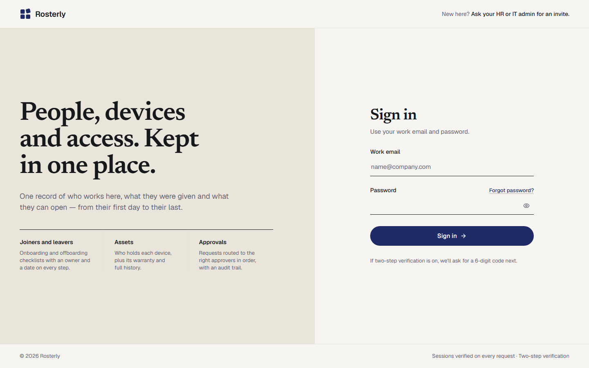
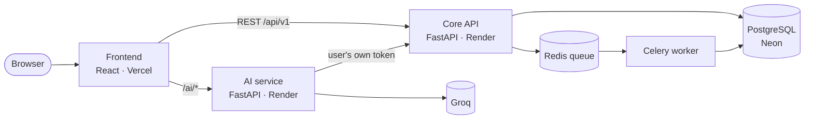

<div align="center">


<h3>People, devices and access, kept in one place.</h3>

<p>A self-hosted portal where HR, IT and managers share one record of every employee,<br/>from their first day to their last.</p>

<p>
  <a href="https://rosterly-alpha.vercel.app"><b>Live demo</b></a> ·
  <a href="#getting-started">Getting started</a> ·
  <a href="#how-it-works">How it works</a> ·
  <a href="#deployment">Deployment</a>
</p>

[](https://github.com/kk161205/Rosterly/actions/workflows/ci.yml)

<br/>



</div>

<br/>

## Why Rosterly

When someone joins a company, HR opens a record, IT hands over a laptop, someone buys a licence seat and a manager approves it, usually in four different tools. When they leave, half of that is forgotten: the laptop stays out, the seat keeps billing, the account keeps working.

Rosterly puts all of it on one record per person:

- **Joining and leaving are checklists** owned by HR, IT and the manager. A leaver can't be signed off while they still hold a device or a licence seat.
- **Requests route themselves** through approval chains chosen by type and cost, then IT or HR fulfils them.
- **Access is checked on every request.** Signing out, a role change or leaving the company stops a session on its very next click.
- **Every change is audited** in plain words, with what it was before and after.

## Features

**People.** Directory and org chart, profiles with a document vault, departments, and new joiners added in one step with a set-password link (there is no self sign-up).

**Joining and leaving.** Onboarding and offboarding checklists per team, with devices and seats reclaimed before sign-off.

**Assets.** Inventory from purchase to retirement, printable QR labels with a camera scanner for check-in and check-out, and maintenance tickets as a table or a board.

**Licences.** Seats bought against seats used, cost per seat and renewal dates, with seats given and freed per person.

**Requests.** One portal for equipment, access, IT help and anything else. Approval chains are set by super admins, and approvers decide from the "Waiting on you" list on Home.

**Leave and attendance.** Company-defined leave types and holidays, working-day counting, carry-over, pro-rating for joiners, exact refunds on cancellation and daily check-in.

**Analytics.** Money to save, where the money went, what to budget for, what needs chasing and where work is slow. Each total opens the records behind it, with CSV export.

**Administration.** Two-step sign-in with an authenticator app, users and roles, company settings, notifications and the audit log.

### Roles

| Role | Sees and does |
| :--- | :--- |
| Super admin | Everything, including roles, approval chains and company settings |
| HR admin | People, joining and leaving, documents, leave settings |
| IT admin | Assets, maintenance, licences and fulfilment |
| Manager | Their team: approvals, the leave calendar and team reports |
| Employee | Their own profile, devices, requests and leave |
| Auditor | Read-only across the company, including the audit log |

A person can hold several roles; their permissions merge. Every rule is enforced by the API, and the interface only hides what a role can't use.

## The Guide

The fourth tile of the logo is an AI assistant. Press <kbd>Ctrl</kbd> + <kbd>K</kbd>, type or speak a question, and it either:

- **answers** from your own data, such as *"How many laptops are in stock?"*, or
- **shows the way**, such as *"How do I add a holiday?"*. It opens the page, tab and form step by step and stops on the final button for you to press.

It is limited by design. The AI service has no database access: it reads through the normal API with your own token, so it never sees more than you can, and it never saves, approves or deletes anything itself. Plain searches are answered in the browser without any AI call, and if the AI is unavailable, <kbd>Ctrl</kbd> + <kbd>K</kbd> still works as a search.

When HR adds a new joiner, Rosterly also suggests the usual devices and licence seats from similar recent joiners (*"9 of 11 similar joiners got this"*). This uses plain similarity scoring, not a language model.

## How it works



| | Built with |
| :--- | :--- |
| **Frontend** | React 19, TypeScript, Vite, Tailwind CSS, TanStack Query, Radix UI |
| **Core API** | Python 3.13, FastAPI, SQLAlchemy 2, Alembic, Pydantic 2 |
| **AI service** | FastAPI with the Groq API (`gpt-oss-20b`, `gpt-oss-120b`, `whisper-large-v3-turbo`) |
| **Data and jobs** | PostgreSQL 18, Celery with a Redis-compatible queue |
| **Quality** | pytest, Ruff, Vitest, Testing Library, ESLint, GitHub Actions |

<details>
<summary><b>Repository layout</b></summary>

```text
Rosterly/
├── backend/
│   ├── app/
│   │   ├── core/               # config, auth, access control, Celery
│   │   ├── models/             # SQLAlchemy models
│   │   └── modules/<feature>/  # router · service · schemas
│   ├── alembic/                # migrations, which also seed roles and permissions
│   ├── tests/                  # pytest on SQLite
│   ├── tests_pg/               # end-to-end flows on PostgreSQL
│   └── start.sh                # production start: migrate → worker → API
├── ai-service/app/
│   ├── guide/                  # prompts, read-only tools, plan checks, speech
│   └── onboarding/             # joiner suggestions
├── frontend/src/
│   ├── app/                    # routes
│   ├── shell/                  # sidebar, Ctrl K palette, top bar
│   ├── guide/                  # the Guide: overlay, planner, runner, voice
│   ├── features/<feature>/     # pages, components, services, page map, tests
│   ├── ui/                     # design-system primitives
│   └── lib/                    # API client, formatting, URL filters
├── render.yaml                 # Render blueprint
└── .github/workflows/ci.yml
```

</details>

## Getting started

You need Python 3.13, Node 22 and PostgreSQL 18 (local or [Neon](https://neon.tech)). Redis is only needed for background jobs, and a [Groq](https://console.groq.com) key only for the Guide.

**1. Core API**

```bash
cd backend
python -m venv .venv && source .venv/bin/activate   # Windows: .venv\Scripts\activate
pip install -r requirements.txt
cp .env.example .env        # set DATABASE_URL, JWT_SECRET_KEY, MFA_ENCRYPTION_KEY
alembic upgrade head
python -m app.cli bootstrap --email you@company.com --name "Your Name" --department Engineering
uvicorn app.main:app --reload --port 8000
```

`bootstrap` creates the first super admin and prints a one-time link to set the password. API docs are served at <http://localhost:8000/docs>. To run background jobs: `celery -A app.core.celery_app worker -B --pool=solo`.

**2. AI service** (optional)

```bash
cd ai-service
python -m venv .venv && source .venv/bin/activate
pip install -r requirements.txt
cp .env.example .env        # set GROQ_API_KEY
uvicorn app.main:app --reload --port 8100
```

**3. Frontend**

```bash
cd frontend
npm ci
cp .env.example .env        # VITE_API_BASE_URL, VITE_AI_BASE_URL
npm run dev
```

Open <http://localhost:5173> and sign in through the link from `bootstrap`.

> [!NOTE]
> Email stays off until SMTP is configured and `EMAIL_DELIVERY_ENABLED=true`. Until then, invite and reset links are shown to the admin to copy.

## Tests

| Suite | Command | Tests |
| :--- | :--- | ---: |
| Core API | `cd backend && ruff check app tests tests_pg && pytest` | 679 |
| PostgreSQL flows | `TEST_POSTGRES_URL=postgresql+psycopg2://… pytest tests_pg` | 10 |
| AI service | `cd ai-service && ruff check app tests && pytest` | 47 |
| Frontend | `cd frontend && npm run lint && npm test && npm run build` | 204 |

CI runs all four suites on every push and pull request, and also runs every migration up, down and up again on PostgreSQL 18. The AI-service tests replace Groq with fakes, so they need no key.

## Deployment

The live demo runs on free plans. Every push to `main` redeploys it.

| Part | Platform | Defined in |
| :--- | :--- | :--- |
| Frontend | Vercel | `frontend/vercel.json` |
| Core API and Celery worker | Render (Singapore) | `render.yaml` → `rosterly-api`, started by `backend/start.sh` |
| AI service | Render (Singapore) | `render.yaml` → `rosterly-ai` |
| Job queue | Render Key Value | `render.yaml` → `rosterly-queue` |
| Database | Neon PostgreSQL (Singapore) | `DATABASE_URL` |

<details>
<summary><b>Deploy your own copy</b></summary>

1. **Render.** Create a Blueprint from this repository. Keep the services in the same region as your database, because each page makes several queries. Then set the secrets marked `sync: false`:
   - `rosterly-api`: `DATABASE_URL`, `MFA_ENCRYPTION_KEY`, `CORS_ORIGINS` and `FRONTEND_BASE_URL` (the last two are both the Vercel address).
   - `rosterly-ai`: `GROQ_API_KEY`, `CORE_BACKEND_BASE_URL` and `CORS_ORIGINS`.
2. **Vercel.** Import the repository with `frontend` as the root directory, then set `VITE_API_BASE_URL` (the API address followed by `/api/v1`) and `VITE_AI_BASE_URL`. These are read at build time, so redeploy after changing them.
3. **First admin.** Run `bootstrap` once from your machine, with `DATABASE_URL` pointing at the production database and `FRONTEND_BASE_URL` set to the Vercel address.

With `ENVIRONMENT=production`, both services refuse to start on development defaults such as a weak JWT secret, localhost origins or a missing Groq key.

</details>

> [!TIP]
> Free Render services sleep after 15 minutes without traffic, so the first visit can take a few seconds to load.

## Team

Built by Team 145, Department of Computer Engineering & Applications, GLA University, Mathura:
**Kushagra Kulshrestha**, **Venu Gopal** and **Bharti Singh**.
