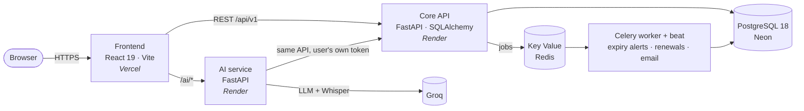

<div align="center">


### People, devices and access, run as one lifecycle.

Rosterly is a self-hosted portal where HR, IT and managers share one record of every employee:<br/>
the laptop on their desk, the licences they use, the requests they raise and the checklists that bring them in and see them out.

[](https://github.com/kk161205/Rosterly/actions/workflows/ci.yml)


[Features](#features) · [The Guide](#the-guide) · [Architecture](#architecture) · [Quick start](#quick-start) · [Tests](#tests) · [Deployment](#deployment)

</div>

---

## Why Rosterly

When someone joins a company, HR opens a record, IT orders a laptop, someone buys a licence seat, and a manager approves it, usually in four different tools. When they leave, half of that is forgotten. Rosterly keeps all of it on one timeline:

- **One record per person**: profile, documents, devices, licence seats, leave and history in one place.
- **Joining and leaving as checklists** owned by HR, IT and Facilities. A leaver can't be signed off while they still hold a device or a seat.
- **Requests that route themselves** through approval chains set by cost, and no one approves two steps of the same request.
- **Zero-trust access**: every request re-checks the session, the role and the record's scope. A revoked session stops on its very next click.

## Features

<table>
<tr>
<td width="50%" valign="top">

**👥 People**
- Directory, org chart and full profiles with a document vault
- Onboarding and offboarding checklists per role
- Leave balances with carry-over, holidays, team calendar and attendance

**💻 Assets**
- Inventory from purchase to retirement, with expected life
- Printable QR labels and a camera scanner for check-in and check-out
- Maintenance tickets as a table or a board

**🔑 Licences**
- Seats bought against seats used, cost per seat, renewal dates
- Give and take back seats; a sync point for providers such as Microsoft 365

</td>
<td width="50%" valign="top">

**📨 Requests and approvals**
- One request portal for equipment, access, IT help and anything else
- Approval chains by request type and cost, in order
- "Waiting on you" on Home: decide without leaving the page

**📊 Analytics**
- Money to save (unused seats, idle stock), where the money went
- What to budget for, what needs chasing, where work is slow
- Totals first, records in a side panel, CSV export

**🛡️ Control**
- Six fixed roles, multi-role users, two-step sign-in (TOTP + recovery codes)
- Audit log in plain words, with every change shown before → after
- Notifications in app, with email alerts once SMTP is set

</td>
</tr>
</table>

### Roles

| Role | Sees and does |
| :--- | :--- |
| **Super admin** | Everything, including roles, approval chains and company settings |
| **HR admin** | People, onboarding and offboarding, documents, leave settings |
| **IT admin** | Assets, maintenance, licences, device provisioning |
| **Manager** | Their team: approvals, leave calendar, reports |
| **Employee** | Their own profile, devices, requests and leave |
| **Auditor** | Read-only across the company, including the audit log |

A person can hold several roles. Permissions merge, the widest scope wins, and a role never takes access away.

## The Guide

The fourth tile in the logo is an AI assistant. Press **Ctrl K** (or `/`), type or speak a question, and the tile lifts out of the logo to help:

| You ask | The Guide |
| :--- | :--- |
| *"How do I give someone a laptop?"* | **Shows the way.** It flies to each step (sidebar → tab → button) with a short caption and stops on the final button for you to press. |
| *"How many laptops are in stock?"* | **Answers** from your own data in a side panel, with a small table where it helps. |
| *"Show me the thing"* | **Asks back** with up to three choices. |

**Built to be safe and cheap:**
- **No database access.** The AI service has no connection string. It reads through the normal API with *your* token, so it can never see more than you can, and it never saves anything. Anything that would save, approve or delete waits for your click.
- **Page map first.** Plain searches like "leave" match the app's page map in the browser, with no AI call. A small fast model handles unclear wording, and a larger one is used only when a question needs data. If the AI is down, the Guide still navigates from the page map.
- **Voice input** through Whisper, off until a person turns it on.
- **Switches** for the whole company and for each person, plus a soft accent colour each person picks.

**Onboarding recommendations.** When HR adds a joiner, Rosterly looks at the most similar past joiners (same title, same department) and pre-fills the usual devices and licence seats: *"4 of 5 similar joiners got this"*. This is plain weighted similarity, with no language model, and it stays quiet when there's too little history.

## Architecture



| Layer | Technology |
| :--- | :--- |
| Frontend | React 19, TypeScript, Vite, Tailwind CSS, TanStack Query, Radix UI |
| Core API | Python 3.13, FastAPI, SQLAlchemy 2, Alembic, Pydantic v2 |
| AI service | FastAPI, Groq (`gpt-oss-20b` fast, `gpt-oss-120b` smart, `whisper-large-v3-turbo` speech) |
| Data | PostgreSQL 18; Celery on a Redis-compatible queue for background jobs |
| Quality | pytest, ruff, Vitest, Testing Library, ESLint, GitHub Actions |

<details>
<summary><b>Repository layout</b></summary>

```text
Rosterly/
├── backend/
│   ├── app/
│   │   ├── core/              # config, zero-trust auth, RBAC/ABAC, Celery
│   │   ├── models/            # SQLAlchemy models
│   │   └── modules/<feature>/ # router.py · service.py · schemas.py
│   ├── alembic/               # migrations (they also seed roles and permissions)
│   ├── tests/                 # pytest, self-contained on SQLite
│   ├── tests_pg/              # end-to-end flows on real PostgreSQL
│   └── start.sh               # production start: migrate → worker → API
├── ai-service/
│   └── app/
│       ├── guide/             # prompts, tools, plan checks, speech
│       └── onboarding/        # joiner recommendations
├── frontend/
│   └── src/
│       ├── app/               # routes
│       ├── shell/             # sidebar, Ctrl K palette, top bar
│       ├── guide/             # the Guide: overlay, runner, planner, voice
│       ├── features/<feature>/# pages, components, services, page map, tests
│       ├── ui/                # design-system primitives
│       └── lib/               # API client, formatting, URL filters
├── render.yaml                # Render blueprint: API, AI service, queue
└── .github/workflows/ci.yml
```

</details>

## Quick start

**You need** Python 3.13, Node 22, and PostgreSQL 18 (local or a [Neon](https://neon.tech) database). Redis is needed only for background jobs. A [Groq](https://console.groq.com) key is needed only for the AI.

**1. Core API**

```bash
cd backend
python -m venv .venv && source .venv/bin/activate   # Windows: .venv\Scripts\activate
pip install -r requirements.txt
cp .env.example .env              # set DATABASE_URL, JWT_SECRET_KEY, MFA_ENCRYPTION_KEY
alembic upgrade head              # schema, roles and permissions
python -m app.cli bootstrap --email you@company.com --name "Your Name" --department Engineering
uvicorn app.main:app --reload --port 8000
```

`bootstrap` creates the first super admin on a fresh database and prints a one-time link to set the password. After that, everyone joins through onboarding; there is no self sign-up. API docs are at <http://localhost:8000/docs>.

Background jobs (optional): `celery -A app.core.celery_app worker -B --pool=solo`

**2. AI service** (optional; without it, Ctrl K is a plain search)

```bash
cd ai-service
python -m venv .venv && source .venv/bin/activate
pip install -r requirements.txt
cp .env.example .env              # set GROQ_API_KEY
uvicorn app.main:app --reload --port 8100
```

**3. Frontend**

```bash
cd frontend
npm ci
cp .env.example .env              # VITE_API_BASE_URL, VITE_AI_BASE_URL=http://localhost:8100
npm run dev
```

Open <http://localhost:5173> and sign in with the link from `bootstrap`.

> [!NOTE]
> Email stays off until real SMTP details are set and `EMAIL_DELIVERY_ENABLED=true`. Until then, invite and reset links are shown to the admin to copy.

## Tests

The same commands run in CI on every push and pull request.

| Suite | Command | Tests |
| :--- | :--- | ---: |
| Core API | `cd backend && ruff check app tests tests_pg && pytest` | 673 |
| PostgreSQL flows | `TEST_POSTGRES_URL=postgresql+psycopg2://… pytest tests_pg` | 10 |
| AI service (Groq and the API faked, no key needed) | `cd ai-service && ruff check app tests && pytest` | 46 |
| Frontend | `cd frontend && npm run lint && npm test && npm run build` | 194 |

CI also runs every migration up, down and up again on PostgreSQL 18.

## Deployment

| Part | Platform | Defined in |
| :--- | :--- | :--- |
| Core API + Celery worker | Render web service | `render.yaml` → `rosterly-api`, started by `backend/start.sh` |
| AI service | Render web service | `render.yaml` → `rosterly-ai` |
| Job queue | Render Key Value | `render.yaml` → `rosterly-queue` |
| Frontend | Vercel | `frontend/vercel.json` (root directory `frontend`) |
| Database | Neon | `DATABASE_URL` |

1. **Render**: create a Blueprint from this repo. Every service runs in Singapore, next to the Neon database; if your Neon project is in another region, change `region` in `render.yaml` to match, because each page makes many queries. Then set the secrets marked `sync: false`:
   - On `rosterly-api`: `DATABASE_URL`, `MFA_ENCRYPTION_KEY`, `CORS_ORIGINS` and `FRONTEND_BASE_URL` (the last two are both the Vercel address).
   - On `rosterly-ai`: `GROQ_API_KEY`, `CORE_BACKEND_BASE_URL` and `CORS_ORIGINS`.
2. **Vercel**: import the repo with `frontend` as the root directory. Set `VITE_API_BASE_URL` (the API address + `/api/v1`) and `VITE_AI_BASE_URL`. These values are baked in at build time, so redeploy after changing them.
3. **First admin**: Render's free plan has no shell. Run `bootstrap` once from your own machine, with `DATABASE_URL` pointing at the production database and `FRONTEND_BASE_URL` set to the Vercel address, so the printed link opens the live site.

With `ENVIRONMENT=production`, both services refuse to start on development defaults (a weak JWT secret, localhost origins, a missing Groq key).

> [!TIP]
> On free plans, Render services sleep after 15 minutes idle, so the first request takes a few seconds to wake them. Groq's free tier allows about 8,000 tokens per minute per model; when one model is busy, the Guide falls back to the next.

## Team

Built by **Team 145**, Department of Computer Engineering & Applications, GLA University, Mathura:

**Kushagra Kulshrestha** · **Venu Gopal** · **Bharti Singh**
